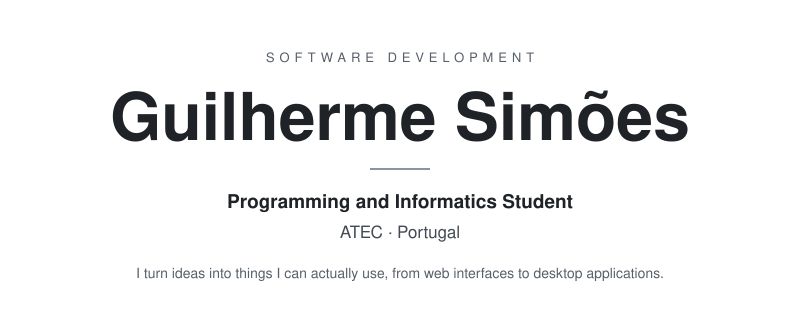
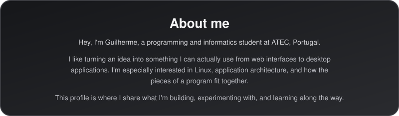
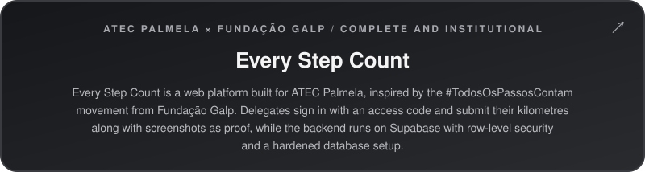
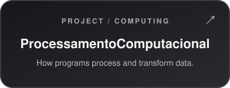

 

  
  
  
  
  
  
  
  
  
  
  
  
  
 

 

 

 

<h2 data-importer="text" align="center">Featured Projects</h2>
 

 

<table>
  <tr>
    <td width="50%">
      
    </td>
    <td width="50%">
      
    </td>
  </tr>
</table>
 
